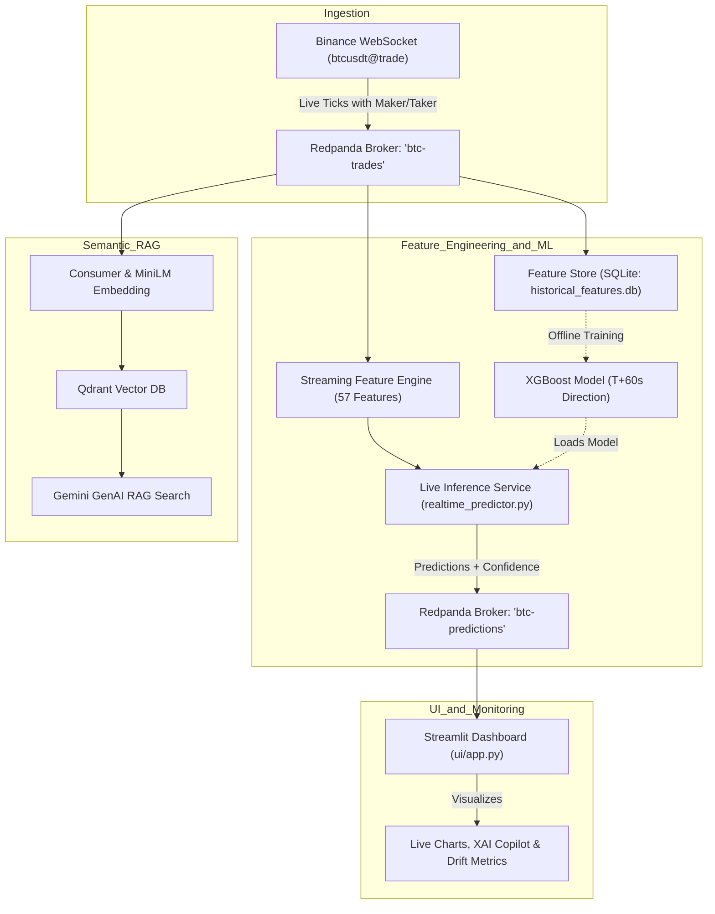

# 📈 Crypto-AI MLOps: Streaming Inference & RAG Pipeline

An end-to-end, production-grade real-time MLOps pipeline that ingests live cryptocurrency trades from Binance, computes 57 high-frequency rolling microstructure features on the fly, serves real-time XGBoost directional price predictions via Redpanda, and provides an interactive Streamlit dashboard featuring live performance/drift monitoring and an Explainable AI (XAI) + Generative AI RAG interface.

---

## 🏗️ Architecture



---

## 🎯 Prediction Task Definition

* **Target Variable:** Short-term price direction (**Binary Classification: `1` for UP, `0` for DOWN/FLAT**).
* **Prediction Horizon:** Next 60 seconds ($T + 60\text{s}$).
* **Why this task?** In high-frequency cryptocurrency markets, predicting raw regression price targets is noisy and susceptible to tick-level microstructure variance. Predicting directional momentum over a fixed 60-second horizon is robust, actionable, and aligns with order flow dynamics.

---

## 📁 Project Structure

```text
ai-streaming-pipeline/
├── features/
│   └── feature_engineer.py      # Real-time state management & 57 rolling window features
├── training/
│   ├── offline_trainer.py       # Binary XGBoost model trainer with continuous gap handling
│   └── logger_and_trainer.py    # Historical walk-forward benchmark framework
├── inference/
│   └── realtime_predictor.py    # Live streaming inference service (btc-trades -> btc-predictions)
├── ui/
│   └── app.py                   # Streamlit dashboard combining live ML charts, XAI & RAG
├── models/
│   ├── model.pkl                # Trained production XGBoost binary model
│   └── model_metadata.json      # Model schema, evaluation metrics & baseline stats for drift
├── historical_features.db       # Historical feature store (140,000+ ticks across 60 dimensions)
├── binance_producer.py          # WebSocket ingestion stream to Redpanda topic 'btc-trades'
├── binance_consumer.py          # Vector embedding ingestion to Qdrant vector database
├── docker-compose.yml           # Redpanda broker, Redpanda Console, and Qdrant DB
├── requirements.txt             # Project Python dependencies
└── README.md
```

---

## 🛠️ Tech Stack

* **Streaming Broker:** Redpanda (Kafka API on port `19092`), WebSockets
* **Machine Learning:** XGBoost, Scikit-Learn, Pandas, NumPy
* **Vector Database:** Qdrant (Dockerized on port `6333`)
* **AI & NLP:** Google Gemini (`gemini-1.5-flash`), HuggingFace SentenceTransformers (`all-MiniLM-L6-v2`)
* **Frontend UI:** Streamlit, Plotly, Streamlit-Autorefresh

---

## 🚀 Quickstart Guide

### 1. Clone & Set Up Environment
```bash
git clone https://github.com/your-username/ai-streaming-pipeline.git
cd ai-streaming-pipeline

# Activate your virtual environment
python -m venv venv
venv\Scripts\activate   # Windows
# source venv/bin/activate # Linux/Mac

pip install -r requirements.txt
```

### 2. Start Infrastructure Containers
Ensure Docker Desktop is running, then start Redpanda and Qdrant:
```bash
docker compose up -d
```
* Redpanda Console is available at: `http://localhost:8080`
* Qdrant Web UI is available at: `http://localhost:6333/dashboard`

### 3. (Optional) Re-train the Offline Model
To retrain the binary 60s XGBoost model on the historical feature store:
```bash
python training/offline_trainer.py
```
This updates `models/model.pkl` and `models/model_metadata.json`.

### 4. Run the Pipeline Components
Open 3 separate terminals:

* **Terminal 1 (Ingestion Producer):**
  ```bash
  python binance_producer.py
  ```
* **Terminal 2 (Real-Time ML Inference Service):**
  ```bash
  python inference/realtime_predictor.py
  ```
* **Terminal 3 (Unified Dashboard & UI):**
  ```bash
  streamlit run ui/app.py
  ```

---

## 🔬 Quant & MLOps Features

1. **Order Flow Microstructure:** Ingests maker/taker flags (`is_buyer_maker`) from Binance to compute aggressive buy vs. sell volume imbalance across 5s, 10s, 30s, and 60s windows.
2. **Confidence Deadband:** Quant filter to differentiate high-conviction trades ($P \ge 0.55 \implies \text{UP}$, $P \le 0.45 \implies \text{DOWN}$) from low-signal noise ($0.45 < P < 0.55 \implies \text{NEUTRAL}$).
3. **Production Drift Monitoring:** Tracks real-time prediction distribution shifts against the offline training baseline to alert when market regime changes occur.
4. **Explainable AI (XAI) Trading Copilot:** Allows operators to ask Google Gemini why a specific directional prediction was made based on live order-flow metrics.
